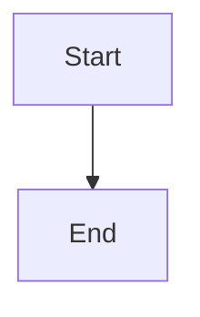

The Mermaid extension adds a diagram block. The block shows only the diagram. Hover it to copy the [Mermaid](https://mermaid.js.org/) source, edit it, or delete the block, or double-click it to edit.

- Pick **Diagram** from the slash menu to insert a diagram. It opens in the editor with an example as the placeholder.
- The editor shows the source next to a live preview. Switch between code, split and preview layouts from the header.
- Click **Apply** or press <kbd>Cmd/Ctrl</kbd>+<kbd>Enter</kbd> to save, or **Cancel** / <kbd>Esc</kbd> to discard. Cancelling a new, empty diagram removes it.
- The preview re-renders 300ms after you stop typing, and follows the `dark` class on `<html>` for light and dark mode.
- Syntax errors show above the last diagram that rendered, so a typo doesn't blank the block.
- Mermaid is loaded with a dynamic import the first time a diagram renders, so it stays out of your initial bundle.
- Mermaid runs with `securityLevel: "strict"`, so diagram labels can't inject scripts or HTML into the page.

<Callout>
  The [Code Block extension](/docs/extensions/code-block) also previews Mermaid:
  set a code block's language to Mermaid and the diagram renders below the code.
  Use the code block when you want the source visible and edited as normal
  document text. Use this extension when you want the diagram as its own block,
  with the source tucked behind an editor.
</Callout>

## Installation

```bash
npx shadcn@latest add "https://www.rtecn.space/r/mermaid.json"
```

This installs `extensions/mermaid`, `extensions/core/`, `extensions/ui/`, and the `mermaid` package.

To install the files manually instead, install these packages and copy the `mermaid`, `core` and `ui` folders from the [package source](https://github.com/shadcn-labs/editorcn/tree/main/packages/extensions/src) into `extensions/`:

```bash
npm install @tiptap/core @tiptap/react @tiptap/pm mermaid lucide-react clsx tailwind-merge
```

## Usage

Add `Mermaid` to the extensions and `MermaidToolbar` to the toolbar. The toolbar button inserts a new diagram and opens its editor. Its tooltip reads Diagram; pass `label` to change it. The copy, edit and delete actions come from a built-in node view.

```tsx
"use client";

import { useEditor } from "@tiptap/react";
import { StarterKit } from "@tiptap/starter-kit";

import { RichTextEditor } from "@/components/editor";
import { Mermaid } from "@/components/extensions/mermaid";
import { MermaidToolbar } from "@/components/extensions/mermaid/toolbar";

import "@/components/editor/style.css";

export function MyEditor() {
  const editor = useEditor({
    immediatelyRender: false,
    extensions: [StarterKit, Mermaid],
  });

  return (
    <RichTextEditor editor={editor}>
      <RichTextEditor.Toolbar>
        <RichTextEditor.ControlsGroup>
          <RichTextEditor.Bold />
          <RichTextEditor.Italic />
          <MermaidToolbar editor={editor} />
        </RichTextEditor.ControlsGroup>
      </RichTextEditor.Toolbar>
      <RichTextEditor.Content />
    </RichTextEditor>
  );
}
```

### With `@editorcn/block-editor`

Add a **Diagram** item to the slash commands:

```tsx
"use client";

import { useEditor } from "@tiptap/react";
import { StarterKit } from "@tiptap/starter-kit";

import {
  BlockEditor,
  SlashCommand,
  getSlashCommandSuggestion,
} from "@/components/block-editor";
import {
  Mermaid,
  mermaidSlashCommandItem,
} from "@/components/extensions/mermaid";

import "@/components/block-editor/style.css";

export function MyBlockEditor() {
  const editor = useEditor({
    immediatelyRender: false,
    extensions: [
      StarterKit,
      Mermaid,
      SlashCommand.configure({
        suggestion: getSlashCommandSuggestion([mermaidSlashCommandItem]),
      }),
    ],
  });

  return <BlockEditor editor={editor} />;
}
```

<ExtensionPreview slug="mermaid" editor="block" />

## Commands

```tsx
editor.commands.setMermaid();
editor.commands.setMermaid({ value: "graph TD\n  A[Start] --> B[End]" });
```

| Command      | Description                                                                          |
| ------------ | ------------------------------------------------------------------------------------ |
| `setMermaid` | Inserts a diagram. Pass `value` to set the source, or leave it out for an empty one. |

## Settings

### `HTMLAttributes`

HTML attributes added to the diagram wrapper.

```tsx
Mermaid.configure({ HTMLAttributes: { class: "my-diagram" } });
```

## Attributes

| Attribute | Type             | Default | Description         |
| --------- | ---------------- | ------- | ------------------- |
| `value`   | `string \| null` | `null`  | The Mermaid source. |

The source is stored as a node attribute, not as editable text. Each **Apply** is one change, so a single undo reverts it. In a collaborative document, two people editing the same diagram at once don't merge: the last apply wins.

## Output

The source is kept inside a code element, so HTML read without this extension still shows it as a code block.

{/* prettier-ignore */}
```html
<div data-type="mermaid"><pre><code class="language-mermaid">graph TD
  A[Start] --&gt; B[End]</code></pre></div>
```

```json
{
  "type": "mermaid",
  "attrs": { "value": "graph TD\n  A[Start] --> B[End]" }
}
```

With the [Markdown extension](/docs/extensions/markdown), diagrams round-trip as fenced `mermaid` blocks. If the source contains backticks, the fence gets longer so it can't close early:

````markdown

````

If the Code Block extension is also installed, `mermaid` fences become diagram blocks and every other fence stays a code block.

## Static Renderer

The [Static Renderer](/docs/static-renderer) styles `div[data-type="mermaid"]` as a card with the source inside it, so the output still works in server components and without JavaScript. Mermaid draws in the browser, so the diagram comes from a client component, which shows the source until Mermaid has loaded and keeps it if the source has a syntax error.

### HTML

Wrap the renderer in `MermaidDiagrams`. It finds the diagrams in the rendered HTML and draws them, and redraws when the content or the theme changes:

```tsx
import { StaticRenderer } from "@/components/static-renderer";
import { MermaidDiagrams } from "@/components/extensions/mermaid";

<MermaidDiagrams>
  <StaticRenderer content={html} />
</MermaidDiagrams>;
```

### JSON

Map the node to `MermaidPreview`:

```tsx
import { StaticRenderer } from "@/components/static-renderer";
import { Mermaid, MermaidPreview } from "@/components/extensions/mermaid";

<StaticRenderer
  content={json}
  extensions={[StarterKit, Mermaid]}
  options={{
    nodeMapping: {
      mermaid: ({ node }) => (
        <div data-type="mermaid">
          <MermaidPreview value={node.attrs.value} />
        </div>
      ),
    },
  }}
/>;
```

`MermaidDiagrams` also works around JSON output, so you can skip the `nodeMapping` and wrap the renderer instead.
